<div align="center">




[PROJECTS](https://github.com/raghav4444?tab=repositories) · [TECH STACK](#tech-stack) · [GITHUB TELEMETRY](#github-telemetry) · [LINKEDIN](https://www.linkedin.com/in/raghvendra-singh4444)

</div>

---

### `01 // ABOUT`

```yaml
name: Raghvendra Singh
handle: raghav4444
role: Full Stack Developer
location: Kanpur, Uttar Pradesh, India
focus: [Full-stack products, AI integration, DSA, system design]
```

### `02 // PROJECT_REGISTRY`

| Project | Description |
|---|---|
| [Studex](https://github.com/raghav4444?tab=repositories) | Student networking platform |
| [Studify](https://github.com/raghav4444?tab=repositories) | AI study planner; 3rd place at AKTU AI Tech Confluence 2025 |
| [Omnifood](https://github.com/raghav4444?tab=repositories) | Responsive healthy-meal website |

### `03 // TECH_STACK`

<div align="center">

</div>

### `04 // GITHUB_TELEMETRY`


<h3 align="center">01 // GITHUB_OVERVIEW</h3>

<div align="center">

<a href="https://github.com/raghav4444?tab=repositories">
  
</a>
<a href="https://github.com/raghav4444?tab=repositories">
  
</a>

<a href="https://github.com/raghav4444?tab=stars">
  
</a>
<a href="https://github.com/raghav4444?tab=repositories">
  
</a>

</div>


<h3 align="center">02 // CONTRIBUTION_INTELLIGENCE</h3>

<div align="center">


<a href="https://github.com/raghav4444">
  
</a>

</div>


<h3 align="center">03 // DEVELOPER_ANALYTICS</h3>

<div align="center">


<br/>

<a href="https://github.com/raghav4444?tab=repositories">
  
</a>

<a href="https://github.com/raghav4444?tab=repositories">
  
</a>

</div>


### `05 // CONNECT`

<div align="center">
<a href="https://github.com/raghav4444"></a>
<a href="https://www.linkedin.com/in/raghvendra-singh4444"></a>
<a href="mailto:raghavsingh99199@gmail.com"></a>
<a href="https://portfolio-2-0-seven-virid.vercel.app/"></a>
</div>

<div align="center"><sub>Dashboard refreshed by GitHub Actions. README links are clickable; arbitrary JavaScript is not supported in GitHub README files.</sub></div>
