<!-- =========================================================
     RAGHVENDRA SINGH — GITHUB PROFILE README
     DESIGN: CINEMATIC BREAKDOWN + NEOTERMINAL
     
     IMPORTANT:
     1. Generate the Breakdown template assets first.
     2. Keep the generated SVGs in the ./assets/ directory.
     3. Update project links to individual repositories when available.
     4. GitHub README files support HTML and Markdown, but not arbitrary JavaScript.
     ========================================================= -->

<!-- ==================== 00 // CINEMATIC HERO ==================== -->
<!-- Uses the generated Breakdown artwork with automatic light/dark switching. -->

  <picture>
    <source
      media="(prefers-color-scheme: dark)"
      srcset="./assets/breakdown-hero-dark.svg"
    />
    
  </picture>

<!-- ==================== 00.1 // GENERATED NEOTERMINAL DASHBOARD ==================== -->
<!-- Updated by scripts/update_dashboard.py via .github/workflows/update-dashboard.yml.
     Keep this file at assets/dashboard.svg; the workflow refreshes its contents. -->

  

<!-- ==================== 01 // TERMINAL INTRO ==================== -->
<!-- Keeps your original animated NeoTerminal identity. -->

  <h3>RAGHVENDRA SINGH</h3>
  
<b>Full Stack Developer · AI Integration · Problem Solver</b>

  
  

    <a href="https://github.com/raghav4444?tab=repositories">PROJECTS</a>
    ·
    <a href="#tech-stack">TECH STACK</a>
    ·
    <a href="#github-telemetry">GITHUB TELEMETRY</a>
    ·
    <a href="https://www.linkedin.com/in/raghvendra-singh4444">LINKEDIN</a>
    ·
    <a href="https://portfolio-2-0-seven-virid.vercel.app/">PORTFOLIO</a>
  

<!-- ==================== 02 // ABOUT ==================== -->
<!-- Customize this section as your career and interests evolve. -->

01 // ABOUT
name: Raghvendra Singh
handle: raghav4444
role: Full Stack Developer
location: Kanpur, Uttar Pradesh, India

focus:
  - Full-stack product development
  - AI-powered applications and integrations
  - Data Structures and Algorithms
  - System design and problem solving

philosophy: "Build with purpose. Learn without limits."
status: "Always learning, building, and improving."
Logline. I enjoy turning ideas into practical software — from full-stack web applications to AI-powered tools. I focus on building useful products, exploring new technologies, and strengthening the engineering fundamentals behind them.

Currently focused on: DSA, full-stack engineering, AI integration, and building better developer experiences.
<!-- ==================== 03 // PROJECT REGISTRY ==================== -->
<!-- Replace repository-list URLs with direct project repository URLs when known. -->

02 // PROJECT_REGISTRY
Project	Description
Studex	Student networking platform for connecting and collaborating with peers.
Studify	AI-powered student planner; secured 3rd place at AKTU AI Tech Confluence 2025.
AI Agentic Whiteboard	Collaborative workspace concept combining whiteboarding and AI-assisted workflows.
Omnifood	Responsive healthy-meal website focused on a clean user experience.

  

<!-- ==================== 04 // TECH STACK ==================== -->
<!-- Remove icons for technologies you no longer use or do not want to showcase. -->

03 // TECH_STACK

  
  

  
  
  

<!-- ==================== 05 // GITHUB TELEMETRY ==================== -->
<!-- These cards are dynamically rendered by external services. -->

04 // GITHUB_TELEMETRY
01 // GITHUB_OVERVIEW

  
  

  
  

02 // CONTRIBUTION_INTELLIGENCE
<!-- The activity graph is hosted by an external service. If it fails, remove
     only this image; the contribution snake below is generated separately. -->

  

<!-- NEON SNAKE:
     This URL assumes neon-snake.yml publishes neon-snake.gif to the output branch.
     Confirm that output/neon-snake.gif exists in your repository after a successful
     Actions run. If your workflow uses a different filename, update the URL below. -->

  

03 // BREAKDOWN_RENDER_LOG
<!-- The generated Breakdown script visualizes your contribution history
     and featured repository information. Keep its companion SVG assets. -->

  <picture>
    <source
      media="(prefers-color-scheme: dark)"
      srcset="./assets/breakdown-script-dark.svg"
    />
    
  </picture>

  
How to read the Breakdown

- The shot: Your contribution history becomes a visual landscape.
- The timeline: Daily activity is represented across the contribution period.
- The comp script: Featured repositories are incorporated into the generated artwork.
- The colour chart: Programming language distribution provides a snapshot of your public code.
- The end card: The cinematic closing artwork completes the experience.
  Artwork and exact metrics depend on the generated template assets and available GitHub data.

04 // DEVELOPER_ANALYTICS

  
  

  
  

<!-- ==================== 06 // CONNECT ==================== -->
<!-- Update the email or portfolio URL if your contact details change. -->

05 // CONNECT

  
  
  
  

<!-- ==================== 07 // DAILY MINDSET ==================== -->
<!-- Keep the quotes short and use this section to express your philosophy. -->

06 // DAILY_MINDSET

  

  

<!-- ==================== 08 // CINEMATIC END CARD ==================== -->
<!-- Generated by README Templates. Keep the asset paths in sync with the
     actual filenames exported by your installed version of the template. -->

  <picture>
    <source
      media="(prefers-color-scheme: dark)"
      srcset="./assets/breakdown-end-dark.svg"
    />
    
  </picture>

  
    NeoTerminal dashboard: scripts/update_dashboard.py · Breakdown artwork: README Templates.
    Neon snake: GitHub Actions workflow. Made with curiosity, code, and continuous learning.
  

