<!--
  RAGHVENDRA SINGH — GITHUB PROFILE
  Style: NeoTerminal × Neon Predator
  Keep the artwork files in /assets and the snake workflow in /.github/workflows.
-->

  <picture>
    <source media="(prefers-color-scheme: dark)" srcset="./assets/breakdown-hero-dark.svg" />
    
  </picture>

  <h2>RAGHVENDRA SINGH</h2>
  <h3>Full Stack Developer · AI Integrations · Problem Solver</h3>

  
  

    
    
    
    
  

01 // ABOUT
name: Raghvendra Singh
github: raghav4444
role: Full Stack Developer
location: Kanpur, Uttar Pradesh, India

currently_focusing:
  - Data Structures & Algorithms
  - Full-stack application development
  - AI-powered tools and agentic workflows
  - Backend engineering and system design

engineering_motto: "Build with purpose. Learn without limits."
I enjoy turning ideas into practical software—from full-stack web applications to AI-powered tools and collaborative experiences. I care about useful features, thoughtful interfaces, reliable APIs, and the engineering fundamentals behind the product.

I'm continuously improving my problem-solving skills while building projects that help me learn by shipping.
02 // FEATURED PROJECTS
<table>
  <tr>
    <td width="50%" valign="top">
      <h3>✦ Studex</h3>
      
<b>Student Networking Platform</b>

      
A platform concept for students to connect, share knowledge, and collaborate with peers.

      
<code>React</code> <code>TypeScript</code> <code>Tailwind CSS</code> <code>Supabase</code>

      <a href="https://github.com/raghav4444?tab=repositories">Explore repositories ↗</a>
    </td>
    <td width="50%" valign="top">
      <h3>✦ Studify</h3>
      
<b>AI-Powered Student Planner</b>

      
A student planning project focused on study organization, calendar workflows, and AI-assisted suggestions. Won 3rd place at AKTU AI Tech Confluence 2025.

      
<code>MERN</code> <code>AI Integration</code> <code>Planning</code>

      <a href="https://github.com/raghav4444?tab=repositories">Explore repositories ↗</a>
    </td>
  </tr>
  <tr>
    <td width="50%" valign="top">
      <h3>✦ AI Agentic Whiteboard</h3>
      
<b>Collaborative AI Workspace</b>

      
A workspace concept combining a visual canvas, real-time collaboration, and AI-assisted building workflows.

      
<code>React</code> <code>AI Agents</code> <code>Canvas UX</code>

      <a href="https://github.com/raghav4444?tab=repositories">Explore repositories ↗</a>
    </td>
    <td width="50%" valign="top">
      <h3>✦ Omnifood</h3>
      
<b>Healthy Meal Website</b>

      
A responsive website focused on clear presentation, polished layouts, and a smooth user experience.

      
<code>HTML</code> <code>CSS</code> <code>JavaScript</code>

      <a href="https://github.com/raghav4444?tab=repositories">Explore repositories ↗</a>
    </td>
  </tr>
</table>

  

03 // TECH STACK

  

Area	Tools and concepts
Programming	C, C++, Java, Python, JavaScript, TypeScript
Frontend	React, Next.js, Vite, Tailwind CSS, responsive UI
Backend	Node.js, Express.js, REST APIs, JWT authentication
Data	MongoDB, MySQL, Supabase
AI & Automation	LLM integrations, AI-assisted workflows, prompt engineering, automation
Tools & Cloud	Git, GitHub, Docker, AWS, Postman, VS Code
CS Fundamentals	Data Structures & Algorithms, OOP, DBMS, Operating Systems, Computer Networks

04 // GITHUB STATS

  
  

05 // NEON PREDATOR — CONTRIBUTION MATRIX

  

  Custom animated contribution matrix · Neon glow · Temporary cell-eating energy pulses · Generated by <code>scripts/generate_neon_snake.py</code>.

06 // CURRENT MINDSET

  

  Curiosity → Experimentation → Building → Iteration

  I believe consistent practice and real projects are among the best ways to become a better engineer.

  <picture>
    <source
      media="(prefers-color-scheme: dark)"
      srcset="./assets/breakdown-end-dark.svg"
    />
    
  </picture>

  Designed around curiosity, built with code, and improved one iteration at a time.

07 // LET'S CONNECT

  
  
  
  

